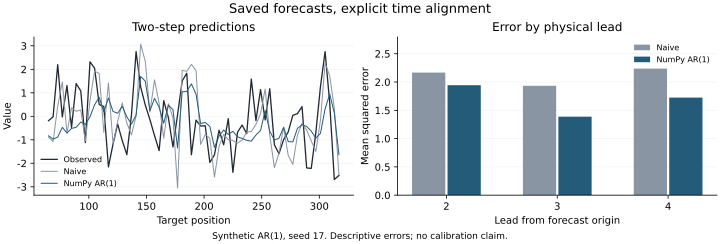

# 导入已有预测 / Saved predictions

`BacktestResult.from_predictions(y, predictions, *, splits)` 把已保存的模型预测接入现有评分、固定样本比较与连续比较，不调用或重新训练模型。它不增加核心依赖。

**版本：开发版新增，v0.11.0 发布包尚未包含。** 从包含该接口的源码 checkout 安装：`python -m pip install -e .`。

## 最小例子

```python
from strategy_inference import BacktestResult, evaluate_forecasts, rolling_splits

y = [1, 2, 3, 4, 5, 6, 7, 8]
splits = rolling_splits(8, initial_train_size=3, window=3, horizon=2, gap=1)
predictions = {
    "naive": [[3, 3], [4, 4], [5, 5]],
    "linear": [[5, 6], [6, 7], [7, 8]],
}
run = BacktestResult.from_predictions(y, predictions, splits=splits)
scores = evaluate_forecasts(run, loss="squared")
print(scores.lead_times)  # (2, 3), because gap=1
print(scores.mean_loss)   # [[4., 0.], [9., 0.]]: lead × model
```

三个起点分别为 2、3、4；第一个起点的目标是位置 4、5。位置 5 会在不同起点重复出现，表示两次不同的预测发行，必须保留。这只是对齐示例，样本太短，不用于推断。

## 数据约定

| 输入 | 约定 |
| --- | --- |
| `y` | 完整、有限、等间隔的一维真实值序列。位置从零开始；不解析日期、重采样、填补或删除缺失值。 |
| `predictions` | 非空 `{模型名: 二维实数数组}`；每个数组严格为 `(folds, horizon)`，行按所给切分，列按目标位置。映射插入顺序决定最终模型轴。 |
| `splits` | 非空 `RollingSplit` 序列；整数、边界、非空训练/目标区间、`origin=train_stop-1` 均须有效。起点严格递增，各折使用相同 horizon 与 gap。可直接使用 `rolling_splits`。 |

NaN、无穷、复数、布尔预测、被掩码的值和维度不一致都会报错，不会静默丢掉模型或目标。输入数组和切分列表之后的修改不会影响结果，返回的数值数组只读。

**导入校验检查的是显式声明的时间表，不证明预测产生过程无泄漏。** 训练区间按调用者声明保留；软件无法判断外部模型是否真的只用了这些历史数据、是否偷偷读取了未来标签，或候选是否曾在测试集上挑选。应保存外部模型的训练配置、数据版本与发行时点；未知训练范围时不要虚构。该接口不处理训练发布延迟、稀疏/变化步长或不规则日历。

## 按任务选择入口

| 任务 | 接口与附加条件 |
| --- | --- |
| 查看每个模型、每个步长的误差 | `evaluate_forecasts(run)`。按步长分别汇总，重叠目标不展开为独立样本。 |
| 在固定测试段比较一个预先指定基线 | `compare_forecasts(run, baseline=..., lead_time=...)`。起点还须等间隔；损失差需满足平稳、弱依赖、矩与非退化条件。 |
| 随标签成熟持续排除模型 | `sequential_compare_forecasts(run, lead_time=...)`。相邻起点至少间隔该物理步长，且需符合 strong conditional-superiority 的目标与条件；它不是平均误差排行榜。 |

导入允许不等间隔但递增的起点，后两个统计入口仍各自检查其时序限制。多步比较必须明确指定一个物理 `lead_time`，不会自动挑出效果最好的步长。完整条件见[时序 API](time-series.md)。

## 可复现实例

```bash
python examples/external_predictions.py --output results/smoke/saved-predictions.json
# 可选图片；仅绘图需要 matplotlib / figures extra
python examples/external_predictions.py --figure results/smoke/saved-predictions.svg
```

例子在固定种子的模拟序列上，先用独立 NumPy OLS 代码产生滚动 AR(1) 预测，再导入保存的数组。JSON 保留全部预测、真实值、切分和比较结果。`gap=1` 时物理步长是 2、3、4；64 个发行起点按 4 点间隔。模型定义、种子与比较步长在脚本中固定。



该模拟中，2 步 MSE 为 naive `2.1666`、NumPy AR(1) `1.9436`，固定样本比较的调整 p 值约 `0.2830`，未达到预设 `0.05` 阈值。误差和证据分别报告；本例不验证统计校准、算法创新或对真实数据的性能优势。重新运行的最后几位可能受数值库影响。

## 正式验证与开发运行

`benchmarks/forecast_validation.py` 保留既有统计协议。`--mode quick` 记录开发运行、相关源码变更和输入哈希；runner 与协议本身仍须先提交。`--mode full` 还要求源码、包数据和依赖声明干净，并在写结果前重核 commit 与输入哈希。未提交、未跟踪或被 Git 忽略的本地 Python 源码会阻止正式运行。`assume-unchanged` / `skip-worktree` 索引标记及符号链接输入也不适合正式运行；quick 将它们分别记入 `index_flags` / `symlinks`，并明确 `formal_eligible=False`。

这是可审计的源码状态检查；没有锁定整个解释器环境、保证所有平台数值一致，或对运行过程中的任意修改建立事务隔离。开发 quick 记录不能直接冒充来自干净 commit 的正式证据。
